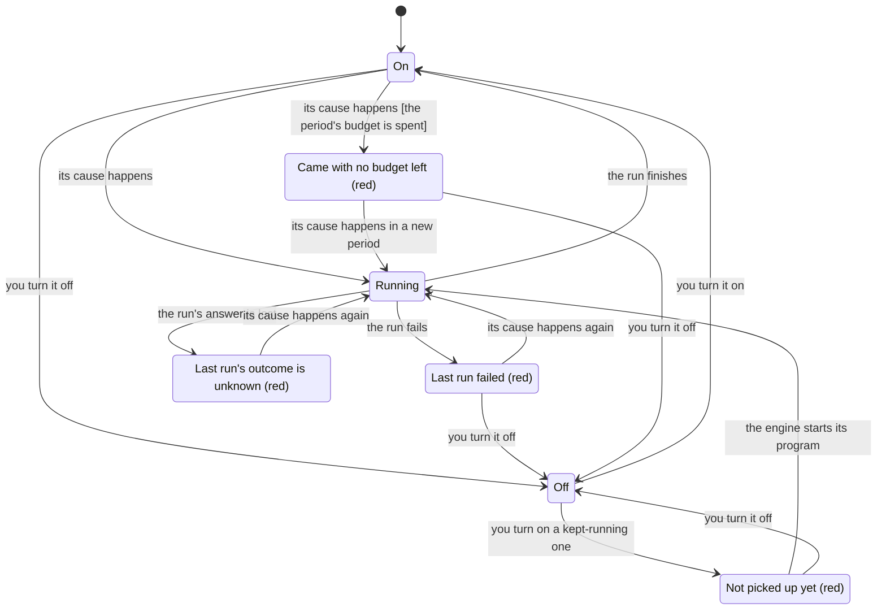

# tools/what-runs-on-its-own/

One screen of everything a person's account runs on its own: each due time, each fact the engine hears and each program it keeps running for a tool. Each row shows what the cause waits for (a due time as its schedule, "every day at 14:00 UTC"), whether it is on, its last run and how it ended, and a switch to turn it off or on.

A cause that should have run and did not is red. That covers a run that failed (with the cause the engine kept for it), a run whose answer was lost, a fact that came with the period's budget spent, and a kept-running program the engine never started. So a guard that quietly stops shows at the moment it stops, not days later. A fact wake that has not heard its first fact has no mark yet; that is not a fault and shows as on. The idea is borrowed from onit (MIT, github.com/neethanwu/onit), which shows a Mac's background jobs and their state in the notch.

The tool only reads. The engine keeps the causes (`src/wake.rs` in the engine) and answers them with `wake:list`: each declared wake, whether it is switched on, and its mark. The caller hands the tool those rows. The switch is the engine's `wake:switch`, called with the row's `{tool, id, on}`.

## Files

| File | Purpose |
|------|---------|
| `do-work/what-runs-on-its-own.mjs` | `tool:see-what-runs-on-its-own`: one row per wake:list row, red first, then switched-on ones. |
| `read-data/states.json` | The states (words, red or not), which state wins when several hold, and the steps between states. A new state is one row. |
| `what-this-tool-does-and-how-to-run-it.json` | The Workshop row the engine reads. The container holds this folder alone. |
| `part.json` | The tool and its states are public. |
| `test/what-runs-on-its-own.test.mjs` | What each kind of wake waits for, every state and why it holds, off winning, red first with counts, the state graph (every state reachable, each with a way out, at most 20 arrows), and the sample run as the container runs it. |

## Key Types / Functions

| Name | Shape | Role |
|------|-------|------|
| Input | `{ wakes: [{tool, id, on, budget, switched_on, mark}] }` | The rows `wake:list` answers. `on` is `{fact: {kind, from, match?, watch?}}` or `{running: {}}`. |
| A row | `{ tool, id, waits_for, state, label, red, why, also, last_run_ms, last_outcome, switch: {tool, id, on, turn, label} }` | `also` lists the other states that hold. |
| Mark (from wake:list) | `{ on?, fired_ms?, ran_ms?, outcome?: "ran" \| "failed" \| "unknown", outcome_cause?, unfunded_ms?, running? }` | Kept by the engine for each wake. |

## The states

The chart is drawn from `read-data/states.json` (15 arrows). Red states are marked.



## Run

```sh
node do-work/what-runs-on-its-own.mjs < input.json
node --test test/what-runs-on-its-own.test.mjs
```
