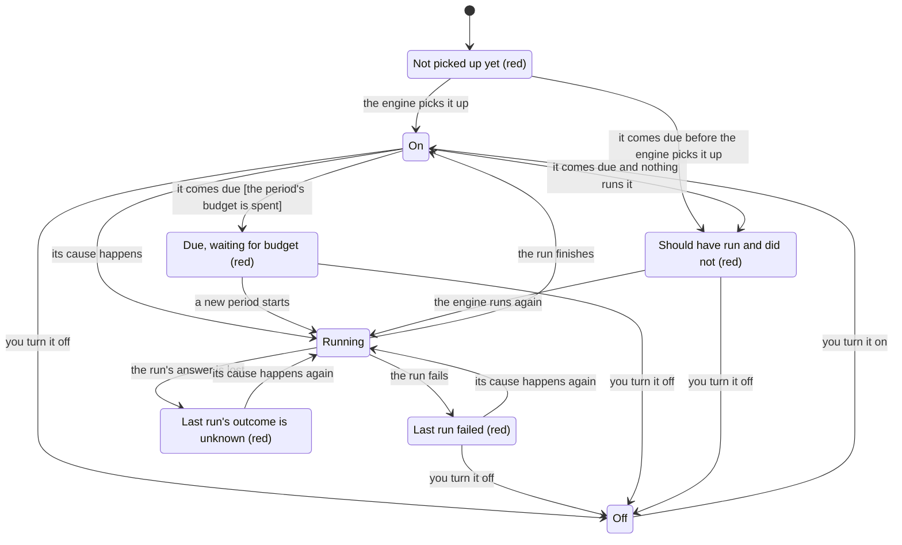

# tools/what-runs-on-its-own/

One screen of everything a person's account runs on its own: each schedule, record change and incoming event the engine wakes a tool for. Each row shows what the cause waits for, whether it is on, its last run and how it ended, its next run, and a switch to turn it off or on.

A cause that should have run and did not is red. That covers a run that failed, a run whose answer was lost, a cause due while the period's budget is spent, a cause past due that nothing ran, and a cause the engine never picked up. So a guard that quietly stops shows at the moment it stops, not days later. The idea is borrowed from onit (MIT, github.com/neethanwu/onit), which shows a Mac's background jobs and their state in the notch.

The tool only reads. The engine keeps the causes (`src/wake.rs` in the engine, one wake book record per account). The caller hands the tool that record, the declared wakes and the time now. The switch is the engine's `switch`, called by the door with the row's `{tool, id, on}`.

## Files

| File | Purpose |
|------|---------|
| `do-work/what-runs-on-its-own.mjs` | `tool:see-what-runs-on-its-own`: one row per declared wake, red first. `wakeKey` is the engine's key for a wake: BLAKE3 of tool, a zero byte, id, a zero byte. |
| `read-data/states.json` | The states (words, red or not), which state wins when several hold, how long past due counts as late, and the steps between states. A new state is one row. |
| `tool-rows.json` | The Workshop row Trillion reads. It packs `tools/content-identity` (BLAKE3) and `@noble/hashes` into the container. |
| `part.json` | The tool and its states are public. |
| `test/what-runs-on-its-own.test.mjs` | Every state and why it holds, off winning, red first with counts, the key against b3sum, the state graph (every state reachable, each with a way out, at most 20 arrows), and the sample run as the container runs it. |

## Key Types / Functions

| Name | Shape | Role |
|------|-------|------|
| Input | `{ now_ms, wakes: [{tool, id, on, budget}], book, stamps?, late_after_ms? }` | `book` is the wake book record, or null before the engine first wrote it. `stamps` gives each watched resource's newest change stamp, so an unread change shows as late. |
| A row | `{ tool, id, waits_for, state, label, red, why, also, last_run_ms, last_outcome, next_run_ms, switch: {tool, id, on, turn, label} }` | `also` lists the other states that hold, for example a failed run under an off switch. |
| Mark (read from the book) | `{ after?, next_ms?, done?, off?, fired_ms?, ran_ms?, outcome?: "ran" \| "failed" \| "unknown", unfunded_ms? }` | Kept by the engine for each wake. |

## The states

The chart is drawn from `read-data/states.json` (17 arrows). Red states are marked.



## Run

```sh
node do-work/what-runs-on-its-own.mjs < input.json
node --test test/what-runs-on-its-own.test.mjs
```
