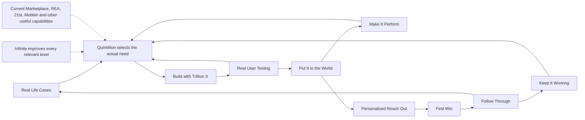

# Quintillion Mode

Quintillion Mode finds the useful thing to do, builds it well, gets it into people's hands and checks whether it actually helps. It keeps discovering and improving as evidence changes.

The modes are reusable workflows in the existing Trillion workflow engine. Any one can be used independently. Quintillion selects the combination that fits the actual situation; it does not force every job through a launch funnel.

| Mode | What it does |
| --- | --- |
| Infinity Mode | Keeps expanding quality, depth, breadth, useful scale and granularity at every relevant level while driving energy, effort, cost, latency and setup toward zero. |
| Trillion X / Hardcore | Questions assumptions, researches reality, removes unnecessary requirements, reuses generic capabilities, makes the change and checks the outcome. |
| Real User Testing | Uses the real interface for the person's actual task, preserves first-attempt friction, repairs the cause and repeats the same journey. |
| Real Life Cases Mode | Discovers actual needs from source material and observed work, keeps source identity and contradictory evidence, and finds shared opportunities. |
| Put It in the World Mode | Makes the useful capability available through its real owner, with relevant videos, articles, case studies, comparisons and Marketplace tools. Checks the actual published destination. |
| Make It Perform Mode | Researches search, answer engines, social discovery and the experience itself; removes observed bottlenecks and measures results. |
| Personalized Reach Out Mode | Reaches relevant source authors, commenters and contacts with specific, truthful messages through suitable channels. Respects opt-outs and bounded follow-up. |
| First Win Mode | Guides new or existing customers through their actual setup, provider, account and payment conditions to a useful first result. |
| Follow Through Mode | Carries the whole dependency chain to its checked consequence, keeping sent, received, acknowledged, acted and benefited states separate. |
| Keep It Working Mode | Detects meaningful changes, repairs regressions and verifies that the customer outcome continues to work. |
| Quintillion Mode | Chooses and connects the modes around the highest-value unresolved need. |

The arrows show a common path, not a required order. Customer feedback can return directly to discovery or repair. Existing customers can start at First Win, Follow Through or Keep It Working. Publication can improve an already live capability without a new build. Each mode can call a relevant mode recursively when there is a new reason and actual evidence; reuse completed work instead of starting the same run again.

Every stage searches both Yours and Everyone's in the current Marketplace. REA, 21st and Mobbin are mandatory capability-review items, alongside an open set of other useful MCPs, tools, workflows and data. Relevant capabilities must produce real output. Unavailable access is recorded honestly with the lost evidence and any suitable equivalent. A name or a configured connection does not prove use.

REA is currently available as the `rea` app through `tool:use-an-app-on-this-computer`, for inspecting how websites and programs work. Discover its current operations before using it, and verify source-specific licenses before adopting implementation material. This is a tool route, not a separate REA workflow. Discover the current 21st and Mobbin routes in the same way; their names do not guarantee connected access or shipping rights.

Granularity includes nested levels and configurable conditions, such as time and permission. Discover the actual settings owners and preserve the person's choices to tune or disable behavior for an account, organization, pursuit or action where those levels apply. The dimensions remain open; this list does not set a ceiling or require irrelevant controls.

Infinity keeps depth/quality, breadth, elapsed time and total energy separately observable. It does not collapse them into one efficiency score or assume that improving one must worsen another. When a conflict appears, investigate whether assumptions, definitions or the architecture create it. Total energy includes money, materials, effort, attention, coordination, motivation, infrastructure, opportunity costs and work transferred to others; track elapsed time separately even when it is also counted as a resource. The chosen dimensions, measures, hierarchy, objectives, experiment-selection method and the questioning process itself are also subject to recursive examination. Those inquiries need real outcome evidence; a possibility is not a demonstrated result.

Infinity is the ignition and continuing improvement principle. There is no assumed ceiling on the aspiration. Each actual pass still has finite capacity, cost, time and concurrency boundaries, cancellation and a useful continuation event. Several independent cases can move together within those bounds. A completed case or pass is not a reason to abandon an ongoing pursuit. Discovery and improvement continue through the existing event and workflow owners until cancellation, expiry or the pursuit's actual closure. Register and read back that continuation before saying the flywheel is running. Recursion without new evidence, idle polling and literal infinite execution are excluded.

The three added coverage modes close common gaps: First Win checks access and onboarding through an actual result; Follow Through checks consequences and customer benefit; Keep It Working checks that benefit survives change. Proven improvements go back into the shared tools, workflows, data and affected owners, so the method improves as well as the individual case.

## Evidence and limits

The modes are defined in `records/quintillion-mode-records.json` and compiled by `src/execution-modes.mjs`. The existing Trillion X standard is reused, including its research and complete-actions requirements. Supplemental Hardcore names resolve to the same mode. Real User Testing resolves the existing account-published workflow by its job rather than inventing its identity.

Keep each run's original request, source references and first failed attempts in that account's private evidence. The shared mode definitions do not fix or erase failures recorded by earlier runs.

Engine tests establish discoverability, aliases, required evidence and refusal of omitted or blocked requirements. They do not establish a published destination, a working customer interface, a running continuation or customer benefit. Those require separate live observations.
